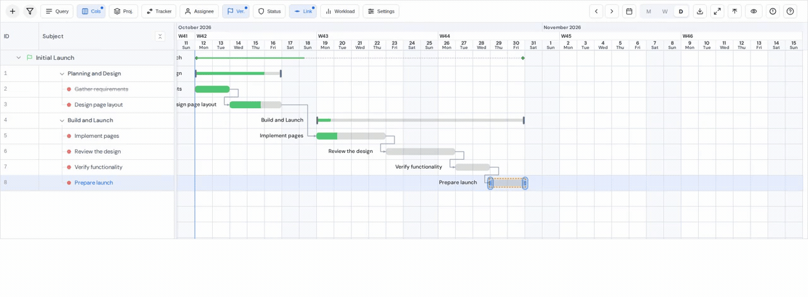

<div align="center">

# Redmine Canvas Gantt

A fast, Canvas-based Gantt chart plugin for Redmine 6.0, 6.1, and 7.0. This README and the user manual describe plugin release v0.18.0.

[English user manual](website/en/index.md) · [日本語マニュアル](website/ja/index.md) · [Developer guide](spa/README.md)

Use the manual's navigation for detailed feature, setup, and administration guidance.

[](LICENSE)
[](https://github.com/tiohsa/redmine_canvas_gantt/actions/workflows/ci.yml)
[](https://github.com/tiohsa/redmine_canvas_gantt/releases)
[](#requirements)
[](#requirements)
[](#requirements)

[Redmine Plugins Directory](https://www.redmine.org/plugins/redmine_canvas_gantt) · [Releases](https://github.com/tiohsa/redmine_canvas_gantt/releases) · [Issues](https://github.com/tiohsa/redmine_canvas_gantt/issues) · [日本語 README](README_ja.md)

</div>

## Why this plugin?

Canvas Gantt brings responsive timeline rendering and direct schedule editing to Redmine projects while using Redmine issues, permissions, and saved queries.

## Key benefits

- **Fast:** Canvas rendering with smooth scrolling and zooming.
- **Interactive:** Edit schedules, dependencies, hierarchy, and issue fields from the chart.
- **Low impact:** No database migration; an uninstall task removes the plugin settings and saved baselines.
- **Compatible:** Targets Redmine 6.0, 6.1, and 7.0.

## Overview

View and edit project issues on a Gantt chart, with a task list beside the timeline.

## Highlights

- Move and resize schedules, edit issue fields, and manage pending changes.
- Organize parent-child issues, manage scheduling links, and narrow or share views with filters and saved queries.
- Compare schedules with baselines, review workload, or measure work with the Work Timer.
- Adjust chart presentation and export PNG or CSV.

## Demo



Watch [schedule editing](./website/public/videos/schedule-edit.mp4) and [dependency creation](./website/public/videos/dependency-create.mp4).

## Requirements

- Redmine 6.0, 6.1, or 7.0 and a Ruby version supported by that Redmine release.
- Redmine REST API enabled and a desktop version of Google Chrome or Microsoft Edge.
- Node.js 20+ only to build the SPA from source; it is not required for normal operation with the included built assets.

<a id="supported-browsers"></a>

### Tested environment

Tested with desktop versions of Google Chrome and Microsoft Edge. Other browsers have not been tested.

### Security and impact

No database migration is required. Access requires `view_canvas_gantt`; baseline saving uses `manage_canvas_gantt_baseline`, and issue actions follow standard Redmine permissions on each target issue's project. Before removing the plugin, run the uninstall task; it deletes the complete plugin settings row, including saved baselines.

## Installation

For a basic installation, clone the v0.18.0 release into Redmine's `plugins/` directory, then restart Redmine:

```sh
cd /path/to/redmine/plugins
git clone --branch v0.18.0 --depth 1 https://github.com/tiohsa/redmine_canvas_gantt.git
```

Enable the REST API and the Canvas Gantt project module, then grant `view_canvas_gantt` to the appropriate roles.

### Upgrade

Back up Redmine and replace the plugin files with the selected release, then restart Redmine and review role permissions. Ordinary upgrades require no database migration.

### Uninstall

Run `bundle exec rake redmine_canvas_gantt:uninstall RAILS_ENV=production` from the Redmine application directory while the plugin is still present, then remove the plugin directory and restart Redmine. This deletes the complete `plugin_redmine_canvas_gantt` settings row, including stored baselines and plugin defaults; browser `localStorage` is not cleared. For Docker, run the task inside the Redmine service.

## Usage

Enable Redmine's REST API, enable **Canvas Gantt** under the project's **Settings → Modules**, grant `view_canvas_gantt`, and open the chart from the project menu. Issue edits, creation, deletion, and relations still require the relevant standard Redmine permissions on the target issue's project; grant `manage_canvas_gantt_baseline` only to roles allowed to save baselines.

### Work Timer

Measure work on an issue and record it through Redmine's standard time-entry form.

### Baseline snapshots

Save one schedule snapshot per project and compare it with the current chart. Saving another snapshot replaces the previous one.

### Workload, display settings, and export

Review planned and actual workload, keep display preferences in the browser profile, and export the current view.

## Shared views, filters, and query parameters

Use supported URL parameters and Redmine saved queries to share business filters and view state.

## Configuration

Canvas Gantt has no plugin configuration screen. Baselines are stored in Redmine plugin settings; display preferences are stored in each browser profile.

### Data payload safety limits

The data endpoint rejects oversized complete payloads instead of returning a truncated task graph; administrators can lower its built-in limits with environment variables.

### Business calendars

Named business calendars can define weekly non-working days, holidays, company shutdowns, and substitute working days. Use either YAML calendar configuration or the single shared `holiday.csv` format in a calendar directory; CSV and YAML files cannot coexist there.

#### Detailed calendars with YAML

YAML supports named calendars, project mapping, inheritance, and working-day overrides.

#### One global holiday list with CSV

Place one `holiday.csv` at the calendar directory root for a shared global holiday list. Do not place YAML calendar files in the same directory.

#### Generate YAML holiday files

The repository includes a tool for generating country holiday calendars.

#### Reload behavior

Calendar files are checked at runtime, and an invalid reload keeps the last valid snapshot.

### Compatibility note

If Redmica UI Extension's Select2 behavior interferes with chart controls, disable searchable select boxes in that extension's settings.

## Docker Quick Start

This repository includes a disposable Docker Compose environment for local Redmine evaluation. It uses sample credentials; do not expose it to a network or use it with production data.

### Start the stack

Use `docker compose up -d --wait` from the repository root.

### Load initial data

Follow the manual navigation above for local initial-data setup. Load test fixtures only into a fresh disposable database; they can overwrite records.

### Enable Canvas Gantt in a project

Enable the project module and grant `view_canvas_gantt` plus the standard Redmine permissions needed for the intended issue actions.

### Stop the stack

Use `docker compose down` from the repository root.

## Development

The SPA is in `spa/`. See [spa/README.md](spa/README.md) for frontend setup and development commands.
