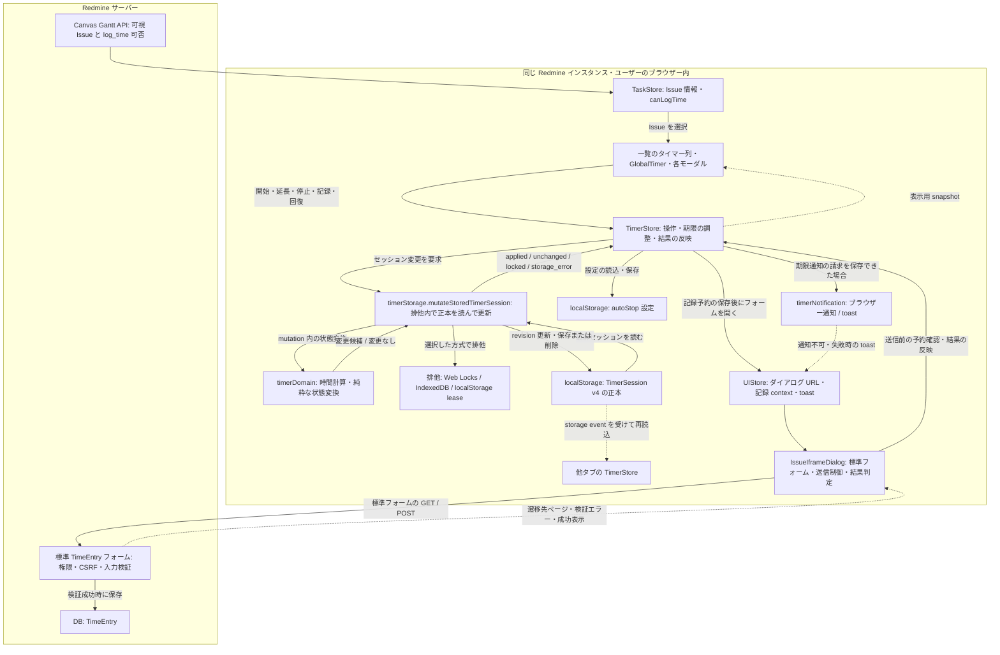
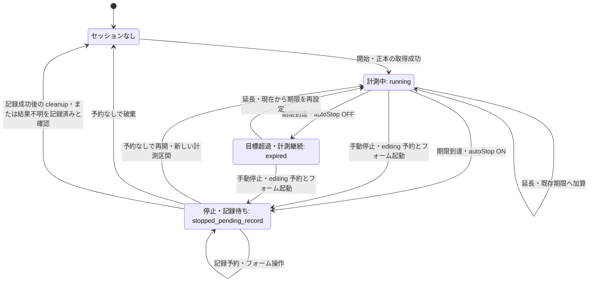
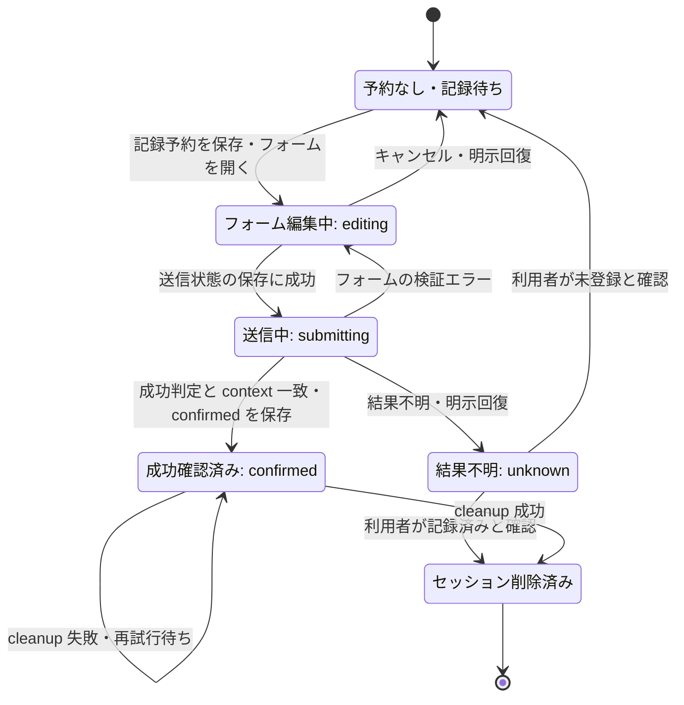
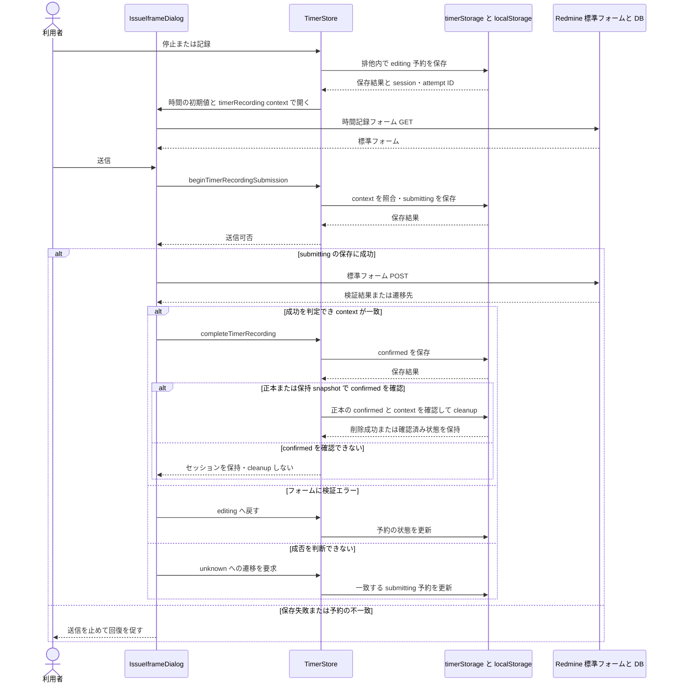

# 作業タイマーのアーキテクチャー

確認日: 2026-11-13。基準: `30e4e6fbdde1ed270bd4ed5e8aeffaee99e17c47`（コード上の 0.20.0）。公開マニュアル v0.19.0 のリリース範囲とは区別する。

旧 PNG の構成図を、現行実装から確認した Mermaid の図に置き換えた。詳細な操作・保存契約の正本は [作業タイマー・時間記録仕様](../specifications/timer.md)。この文書はその構成と実行順序を可視化する。Mermaid 対応の Markdown ビューアーで表示でき、未対応の環境でもコードブロックをテキストとして読める。

## 構成とデータの境界

実線は操作・読込・保存、破線は表示更新・イベント・結果の通知を表す。図の矢印は概念的な依存関係であり、各箱が独立プロセスや API であることを意味しない。

- **タイマーの正本はブラウザー内**にあり、TimeEntry の正本は Redmine の DB にある。タイマー専用のサーバー保存 API はない。計測した時間は標準フォームの初期値へ渡し、フォームが保存する。
- セッションは origin + Redmine の base path + user ID のスコープで共有する。タブ ID は `sessionStorage` に保存し、記録予約の所有者として使用する。別ブラウザー・端末との同期は行わない。
- セッション変更の排他は `timerStorage.ts` 内で実装する。Web Locks があればそれを使い、なければ IndexedDB、さらに localStorage lease の経路を使う。IndexedDB の callback 実行後の障害で同じ mutation を再実行しない。Web Locks の失敗を無条件に別方式で再実行する設計ではない。
- IndexedDB は調停に使い、TimerSession の保存先は localStorage。autoStop の利用者設定はセッションとは別の保存経路を持つ。
- `storage` イベントは相互排他ではなく、他タブが正本を読み直すきっかけ。同一 session ID の古い revision は表示へ採用しない。
- GlobalTimer の毎秒更新は表示用の時計を更新する。期限は `setTimeout` と起動・tick 時の再評価で処理し、毎秒の描画のために共有ロックを取得しない。

## 計測状態

この図の `running`、`expired`、`stopped_pending_record` が `TimerSession.state` の値である。「セッションなし」は localStorage の正本がない状態を表す。図の開始点は新規計測の経路であり、アプリ起動時に必ずこの状態へ戻す意味ではない。起動時は既存の正本を復元し、期限を再評価する。

自動停止時は最後の区間を期限ちょうどで閉じる。手動停止は停止と `editing` 予約を一つのセッション変更で作る。自動停止は予約を作らず、利用者が記録を選んでからフォームを開く。停止中の空白時間は再開後の計測に含めない。

## 記録予約と障害回復

次の図は `recordingAttempt.phase` を表し、前節の `TimerSession.state` とは別である。予約中のセッションは引き続き `stopped_pending_record` に留まる。「予約なし」も phase の値ではない。

図の遷移は、正本上の対象・予約が一致し、必要な保存に成功した場合の経路である。ストレージ障害で `confirmed` 自体を保存できたと確認できない場合まで、成功済み phase が確実に残るとは限らない。表示状態と正本を照合して回復し、フォームを自動再送しない。

**`confirmed` から行うのはローカル cleanup の再試行だけ**である。`editing`／`submitting`／`unknown` に戻したり、Time Entry POST を再送したりしない。予約がある間は通常の再開・延長・破棄・別の記録開始を抑止する。

## Redmine への記録順序

成功判定は「送信中で、直前が時間記録フォーム」という前提に加えて、フォームの消失と成功表示を確認する。遷移先から Issue show の ID を取得できる場合は対象 ID と照合し、取得不能の場合は一致扱いにするのが現行実装である。これとは別に、記録 context の `origin`、session ID、Issue ID、attempt ID と、指定されている owner tab・scope を照合する。単なる iframe の読込完了や HTTP 成功だけでタイマーを削除しない。`confirmed` の確定と cleanup は別々のセッション変更であり、Redmine の保存とブラウザー保存をまたぐ一つのトランザクションではない。

## モデル・通知・失敗時の不変条件

| 領域 | 現行契約 |
| --- | --- |
| 共有モデル | `TimerSession` v4。session ID、revision、Issue、user ID、segments、deadlineAt、autoStop、state、createdAt、updatedAt を保持 |
| 記録予約 | 任意の `recordingAttempt`: id、ownerTabId、openedAt、phase。phase は `editing`／`submitting`／`confirmed`／`unknown` |
| 時刻 | epoch milliseconds の実時刻差を計測。Redmine の date-only 値と混ぜない |
| 読込 | 正本を読むだけでは保存・削除しない。不正データや読込障害をセッション不在として上書きしない |
| 変更失敗 | `locked`／`storage_error` のとき、既存の表示状態を維持する。操作の適用成功と見なさない |
| 起動・期限 | 起動時と期限評価時に正本を再確認。期限前の tick は読込と表示反映で済ませる |
| 通知請求 | 期限の状態変更と同じ mutation で `notifiedDeadlineAt`／`notifiedType` を記録し、適用成功した場合に通知を試みる |
| 通知の制限 | 許可済み Web Notification、失敗・未許可時は toast。請求の保存は通知の配送保証ではなく、通知直前の正本再読込も行わない |
| プラグイン間共有 | `redmine_kanban` と保存キー・schema v4 を共有。schema・phase・version の変更は両方で実装・検証する |

## 実装・テストへの入口

- 操作と期限: [TimerStore](../../spa/src/stores/TimerStore.ts)、[型](../../spa/src/types/timer.ts)、[timerDomain](../../spa/src/domain/timer/timerDomain.ts)。
- 正本と相互排他: [timerStorage](../../spa/src/services/timerStorage.ts)。独立した Timer Mutation Coordinator モジュールはなく、同ファイル内の関数が調停を担う。
- 表示とフォーム: [GlobalTimer](../../spa/src/components/timer/GlobalTimer.tsx)、[UIStore](../../spa/src/stores/UIStore.ts)、[IssueIframeDialog](../../spa/src/components/IssueIframeDialog.tsx)、[結果判定](../../spa/src/domain/timer/timerRecordingOutcome.ts)。
- 通知: [timerNotification](../../spa/src/services/timerNotification.ts)。
- 回帰確認: [domain](../../spa/src/domain/timer/timerDomain.test.ts)、[storage](../../spa/src/services/timerStorage.test.ts)、[store](../../spa/src/stores/TimerStore.test.ts)、[記録結果](../../spa/src/domain/timer/timerRecordingOutcome.test.ts)、[複数タブ E2E](../../spa/tests/e2e/gantt-work-timer-multitab.pw.ts)。これらの参照は、この図の更新時にアプリケーションの全テストを実行したことを意味しない。
