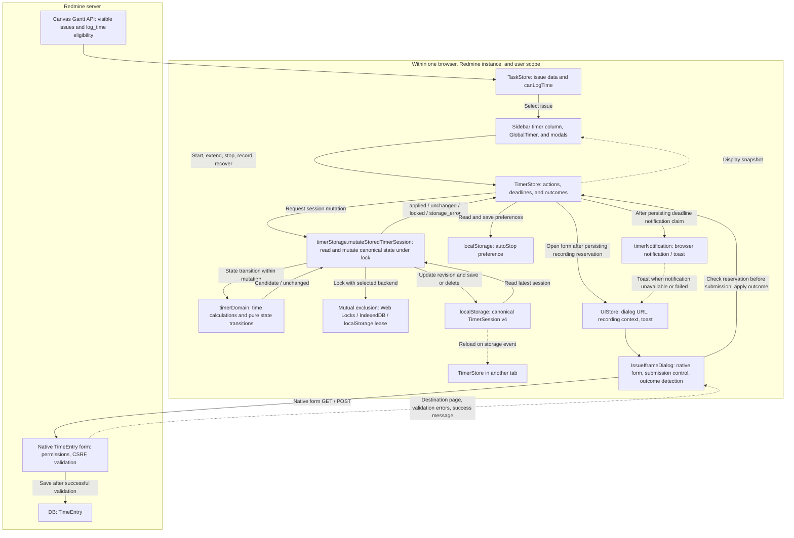

<a id="作業タイマーのアーキテクチャー"></a>

# Work Timer Architecture

Reviewed: 2026-11-13. Reference: `30e4e6fbdde1ed270bd4ed5e8aeffaee99e17c47` (code version 0.20.0). Distinguish this development reference from the public manual's release scope, recorded in the specification index.

The historical PNG architecture diagram was replaced with Mermaid diagrams checked against the implementation. The [Work Timer and time recording specification](../specifications/timer.md) owns detailed interaction and persistence contracts. This document visualizes structure and execution order. Mermaid-capable Markdown viewers render the diagrams; other viewers can display the code blocks as text.

<a id="構成とデータの境界"></a>

## Components and data boundaries



Solid arrows represent actions, reads, and writes; dashed arrows represent display updates, events, and outcome notifications. Arrows show conceptual dependencies; boxes are not necessarily independent processes or APIs.

- **Canonical timer state is browser-local**; canonical TimeEntry data lives in Redmine's DB. There is no timer-specific server persistence API. Measured hours initialize the standard form, which performs the save.
- Session scope is origin + Redmine base path + user ID. Tab IDs are stored in `sessionStorage` and identify recording-reservation ownership. There is no synchronization across browsers/devices.
- Session mutation locking is implemented in `timerStorage.ts`. Use Web Locks when available, otherwise IndexedDB, then the localStorage lease path. Do not rerun the same mutation after an IndexedDB failure following callback execution. Web Locks failures do not unconditionally retry through another backend.
- IndexedDB coordinates operations; TimerSession data stays in localStorage. The autoStop user preference has a persistence path separate from sessions.
- The `storage` event is a trigger for other tabs to reread canonical state, not a mutual-exclusion mechanism. Do not display older revisions of the same session ID.
- GlobalTimer's per-second updates refresh the display clock. Deadlines use `setTimeout` and reevaluation at startup/ticks; per-second rendering does not acquire the shared lock.

<a id="計測状態"></a>

## Measurement states

`running`, `expired`, and `stopped_pending_record` below are `TimerSession.state` values. “No session” means canonical localStorage state is absent. The initial arrow describes starting a new measurement, not resetting state on every application startup. Startup restores existing canonical state and reevaluates deadlines.

```mermaid
stateDiagram-v2
    state "No session" as idle
    state "Measuring: running" as running
    state "Target exceeded; still measuring: expired" as expired
    state "Stopped; awaiting recording: stopped_pending_record" as pending

    [*] --> idle
    idle --> running: Start; acquire canonical session successfully
    running --> running: Extend from existing deadline
    running --> expired: Deadline reached; autoStop OFF
    running --> pending: Deadline reached; autoStop ON
    running --> pending: Manual stop; editing reservation and form opening
    expired --> running: Extend; reset deadline from now
    expired --> pending: Manual stop; editing reservation and form opening
    pending --> pending: Recording reservation and form interaction
    pending --> running: Resume without reservation; new measurement segment
    pending --> idle: Discard without reservation
    pending --> idle: Cleanup after recording success or user confirms unknown outcome as recorded
```



Auto-stop closes the final segment exactly at the deadline. Manual stop and its `editing` reservation are one session mutation. Auto-stop creates no reservation; the form opens only when the user chooses to record. Stopped gaps are excluded when measurement resumes.

<a id="記録予約と障害回復"></a>

## Recording reservations and recovery

The next diagram shows `recordingAttempt.phase`, separate from `TimerSession.state`. A reserved session remains `stopped_pending_record`. “No reservation” is not a phase value.

```mermaid
stateDiagram-v2
    state "No reservation; awaiting recording" as noAttempt
    state "Editing form: editing" as editing
    state "Submitting: submitting" as submitting
    state "Success confirmed: confirmed" as confirmed
    state "Unknown outcome: unknown" as unknown
    state "Session deleted" as removed

    [*] --> noAttempt
    noAttempt --> editing: Persist recording reservation; open form
    editing --> noAttempt: Cancel or explicitly recover
    editing --> submitting: Persist submission state successfully
    submitting --> editing: Form validation errors
    submitting --> confirmed: Success detected and context matches; persist confirmed
    submitting --> unknown: Unknown outcome or explicit recovery
    unknown --> noAttempt: User confirms not recorded
    unknown --> removed: User confirms recorded
    confirmed --> confirmed: Cleanup failed; awaiting retry
    confirmed --> removed: Cleanup succeeded
    removed --> [*]
```



Transitions assume the canonical target/reservation matches and required persistence succeeds. If a storage failure prevents confirming that `confirmed` itself was saved, the successful phase is not guaranteed to remain persisted. Recover by reconciling displayed and canonical state; never automatically resubmit the form.

**From `confirmed`, only retry local cleanup.** Never return to `editing` / `submitting` / `unknown` or resend the Time Entry POST. A reservation blocks ordinary resume, extend, discard, and another recording attempt.

<a id="redmine-への記録順序"></a>

## Recording order in Redmine

```mermaid
sequenceDiagram
    actor user as User
    participant dialog as IssueIframeDialog
    participant store as TimerStore
    participant canonical as timerStorage and localStorage
    participant redmine as Redmine native form and DB

    user->>store: Stop or record
    store->>canonical: Persist editing reservation under lock
    canonical-->>store: Persistence result and session/attempt IDs
    store->>dialog: Open with initial hours and timerRecording context
    dialog->>redmine: GET time-entry form
    redmine-->>dialog: Native form
    user->>dialog: Submit
    dialog->>store: beginTimerRecordingSubmission
    store->>canonical: Match context; persist submitting
    canonical-->>store: Persistence result
    store-->>dialog: Submission eligibility
    alt submitting persisted successfully
        dialog->>redmine: POST native form
        redmine-->>dialog: Validation result or destination
        alt Success detected and context matches
            dialog->>store: completeTimerRecording
            store->>canonical: Persist confirmed
            canonical-->>store: Persistence result
            alt confirmed verified in canonical state or retained snapshot
                store->>canonical: Verify canonical confirmed and context; clean up
                canonical-->>store: Deletion succeeds or retain confirmed state
            else confirmed cannot be verified
                store-->>dialog: Retain session; do not clean up
            end
        else Form validation errors
            dialog->>store: Return to editing
            store->>canonical: Update reservation state
        else Outcome cannot be determined
            dialog->>store: Request transition to unknown
            store->>canonical: Update matching submitting reservation
        end
    else Persistence failed or reservation mismatched
        dialog-->>user: Stop submission and prompt recovery
    end
```

Success detection requires a submission in progress with the preceding page being the time-entry form, then verifies disappearance of the form and a success message. If the destination yields an issue-show ID, compare it with the target. The current implementation treats an unavailable destination ID as matching. Separately, validate recording context `origin`, session ID, issue ID, attempt ID, and any specified owner tab/scope. Iframe load completion or HTTP success alone must not delete the timer. Persisting `confirmed` and cleanup are separate session mutations, not one transaction spanning Redmine and browser storage.

<a id="モデル通知失敗時の不変条件"></a>

## Model, notifications, and failure invariants

| Area | Current contract |
| --- | --- |
| Shared model | `TimerSession` v4: session ID, revision, issue, user ID, segments, deadlineAt, autoStop, state, createdAt, updatedAt |
| Recording reservation | Optional `recordingAttempt`: id, ownerTabId, openedAt, phase; phases are `editing` / `submitting` / `confirmed` / `unknown` |
| Time | Measure differences between epoch-millisecond instants; do not mix with Redmine date-only values |
| Reads | Reading canonical state alone does not save/delete it. Invalid data or read failures must not be overwritten as session absence |
| Mutation failure | Preserve existing display state on `locked` / `storage_error`; do not treat the operation as applied |
| Startup/deadlines | Recheck canonical state at startup and deadline evaluation; pre-deadline ticks only read and update display |
| Notification claims | Record `notifiedDeadlineAt` / `notifiedType` in the same mutation as the deadline transition; attempt notification only after successful application |
| Notification limits | Use authorized Web Notifications, otherwise toast on failure/missing permission. Persisted claims do not guarantee delivery; canonical state is not reread immediately before notification |
| Cross-plugin sharing | Share storage keys/schema v4 with `redmine_kanban`; implement and verify schema/phase/version changes in both plugins |

<a id="実装テストへの入口"></a>

## Implementation and test entry points

- Actions and deadlines: [TimerStore](../../spa/src/stores/TimerStore.ts), [types](../../spa/src/types/timer.ts), [timerDomain](../../spa/src/domain/timer/timerDomain.ts).
- Canonical state and mutual exclusion: [timerStorage](../../spa/src/services/timerStorage.ts). There is no separate Timer Mutation Coordinator module; functions in this file perform coordination.
- Display and forms: [GlobalTimer](../../spa/src/components/timer/GlobalTimer.tsx), [UIStore](../../spa/src/stores/UIStore.ts), [IssueIframeDialog](../../spa/src/components/IssueIframeDialog.tsx), [outcome detection](../../spa/src/domain/timer/timerRecordingOutcome.ts).
- Notifications: [timerNotification](../../spa/src/services/timerNotification.ts).
- Regression references: [domain](../../spa/src/domain/timer/timerDomain.test.ts), [storage](../../spa/src/services/timerStorage.test.ts), [store](../../spa/src/stores/TimerStore.test.ts), [recording outcomes](../../spa/src/domain/timer/timerRecordingOutcome.test.ts), [multi-tab E2E](../../spa/tests/e2e/gantt-work-timer-multitab.pw.ts). These references do not claim the full application test suite ran when updating these diagrams.
